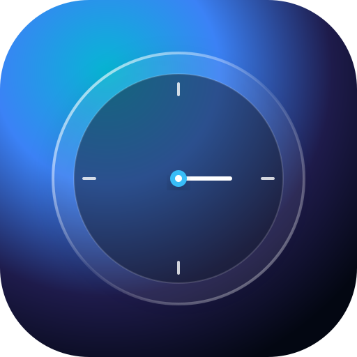

# Chronos — Apple Liquid Glass Clock & Pomodoro Focus PWA

<<<<<<< HEAD
> A modern, high-precision Clock, Timer, and Pomodoro Focus Progressive Web Application designed with Apple's Liquid Glass aesthetic, specular highlights, dynamic themes, and Picture-in-Picture mini mode.

[](https://unusual-0.github.io/clock/)
[](LICENSE)

---

## 🌐 Live Demo
Experience the live application here:  
👉 **[https://unusual-0.github.io/clock/](https://unusual-0.github.io/clock/)**
=======
A modern, high-precision Clock & Pomodoro web application designed in **Apple's Liquid Glass** aesthetic with fluid animations, specular edge highlights, sound haptics, and Picture-in-Picture mini widget mode.


>>>>>>> 601da1f381adde480c3c1a9726e0f2644006c918

---

## ✨ Features

<<<<<<< HEAD
- **Apple Liquid Glass UI**: Multi-layered translucent glass panels, `backdrop-filter` blur + saturation, dynamic specular borders, soft depth shadows, and morphing liquid ambient mesh orbs.
- **World Clock**: Analog sweeping dial, digital time and date, with searchable timezones (London, New York, Tokyo, Paris, Dubai, Dhaka, Singapore, etc.).
- **Alarms**: Customizable alarms with recurrence day selection, toggle switches, and acoustic Web Audio API alerts.
- **Stopwatch**: Drift-free timestamp-based tracking (`performance.now()`), animated liquid circular progress ring, and lap recorder highlighting fastest and slowest splits.
- **Timer**: Rapid presets (1m to 45m), liquid countdown ring, pause/resume, and completion alerts.
- **Focus Pomodoro**: Routine cycles (25m work, 5m break, 30m long break) with customizable durations, round counter, and dynamic palette transitions (warm embers for Work, emerald green for Break).
- **Mini Mode (PIP)**: Shrinks any active session into a floating always-on-top liquid ring widget via Document Picture-in-Picture API with an in-page floating fallback.
- **PWA & Offline Capable**: Built-in Service Worker with stale-while-revalidate caching and one-click install prompt.

---

## 🛠️ Tech Stack

- **Core**: Vanilla JavaScript (ES Modules), HTML5, CSS3 Custom Properties
- **Design**: Apple Liquid Glass (Backdrop Filter Blur/Saturate, Specular Highlights)
- **Audio Engine**: Web Audio API Synthesizer
- **Bundler**: [Vite](https://vitejs.dev/) with `vite-plugin-singlefile`
- **PWA**: Service Worker (`sw.js`), Web App Manifest
- **Hosting**: GitHub Pages via GitHub Actions
=======
### 1. Liquid Glass Aesthetic
- Translucent layered glass surfaces with Apple-style backdrop-blur and saturation filters (`saturate(200%)`).
- Specular multi-angle highlight borders and inset reflections.
- Morphing dynamic liquid ambient orbs in the background.
- Dark & Light mode support with smooth spring transitions.

### 2. World Clock
- Live ticking analog and digital local clock with date display.
- Add and remove international cities (London, New York, Tokyo, Paris, Dubai, Singapore, Sydney, Dhaka, and more).
- Automatic timezone offset calculation.

### 3. Alarm
- Set multiple alarms with custom labels and repeat days (Mon–Sun).
- Toggle alarms on/off with custom glass switches.
- Acoustic chime alerts via Web Audio API + system desktop notifications.

### 4. Stopwatch
- High precision timestamp-based tracking (`performance.now()`), avoiding browser background timer drift.
- Circular liquid progress ring representing seconds progression.
- Lap recording with intelligent fastest (emerald) and slowest (rose) lap indicators.

### 5. Countdown Timer
- Quick presets (1m, 3m, 5m, 10m, 15m, 20m, 30m, 45m).
- Circular liquid fill ring with remaining time.
- Start / pause / resume controls and completion alert bells.

### 6. Focus (Pomodoro Routine)
- **Standard Routine**: 25 min work → 5 min break, 4 rounds, followed by a 30 min long recovery break.
- **Customizable Routine**: Adjust work duration, short break, long break, and round counts.
- **Dynamic Phase Themes**: Automatically morphs colors between Focus (warm fire embers) and Break (emerald calmness).
- Auto-advances across rounds with chime alerts.

### 7. Mini Mode (Always-on-top Widget)
- Shrinks any active session (Stopwatch, Timer, Focus) into a floating liquid glass ring widget.
- Supports **Document Picture-in-Picture API** (native floating desktop window) with an in-page draggable glass fallback.
- Click to expand back to the full application.
>>>>>>> 601da1f381adde480c3c1a9726e0f2644006c918

---

## 🚀 Getting Started

<<<<<<< HEAD
### Prerequisites
- Node.js (v18 or newer)
- npm

### Installation & Local Run
```bash
# Clone the repository
git clone https://github.com/unusual-0/clock.git
cd clock

# Install dependencies
npm install

# Run local development server
=======
### Local Development
```bash
# Install dependencies
npm install

# Start Vite dev server
>>>>>>> 601da1f381adde480c3c1a9726e0f2644006c918
npm run dev
```

Visit `http://localhost:5173/` in your browser.

<<<<<<< HEAD
### Production Build
```bash
# Build bundled single-file application into dist/
npm run build

# Preview production build locally
=======
### Production Build & PWA Testing
```bash
npm run build
>>>>>>> 601da1f381adde480c3c1a9726e0f2644006c918
npm run preview
```

---

<<<<<<< HEAD
## ⚖️ Legal & Privacy

- [Terms of Service](TERMS.md)
- [Privacy Policy](PRIVACY.md)
- [MIT License](LICENSE)

---

## 👤 Author

**Minhaz (Unusual)**  
- GitHub: [@unusual-0](https://github.com/unusual-0)
- Repository: [unusual-0/clock](https://github.com/unusual-0/clock)

---

## 📄 License
This project is open-source software licensed under the [MIT License](LICENSE).
=======
## 📱 PWA & Desktop Packaging
- Fully offline capable via `sw.js` (stale-while-revalidate).
- Installable directly as a native app on Chrome, Edge, Safari iOS, and Android.
- Ready to be wrapped into a Windows `.exe` using Tauri or Electron.

>>>>>>> 601da1f381adde480c3c1a9726e0f2644006c918
